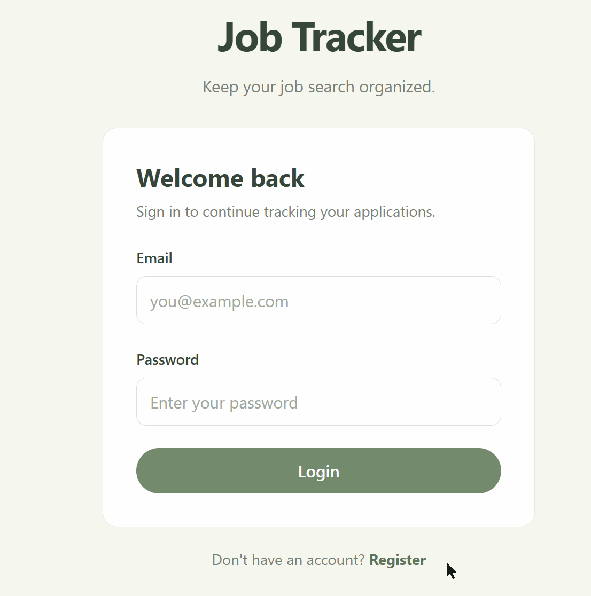
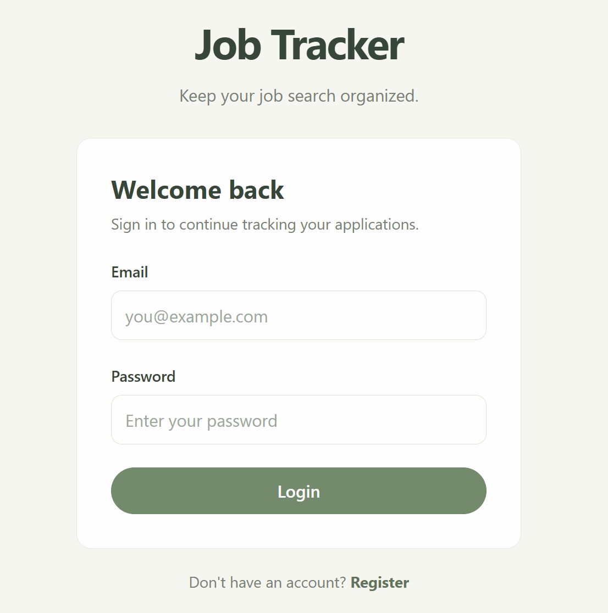
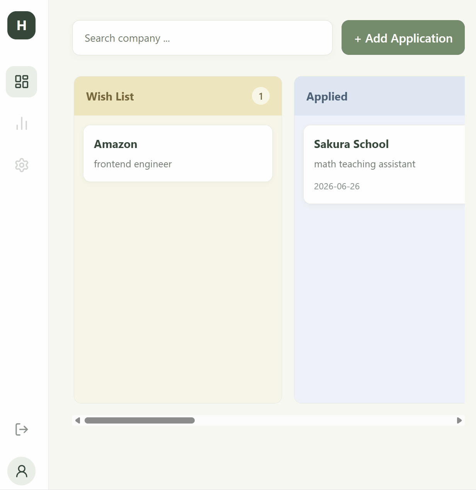
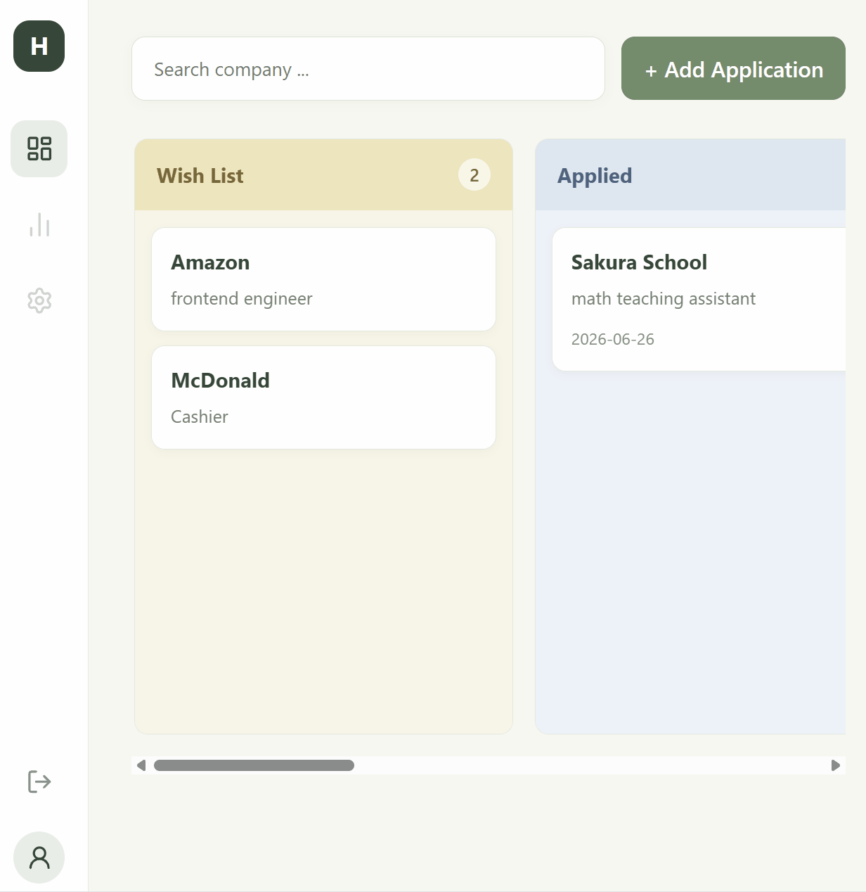
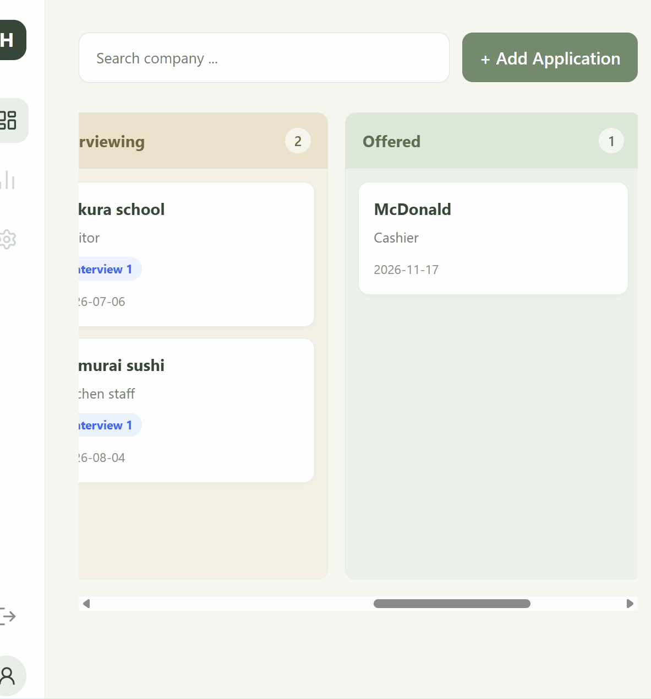
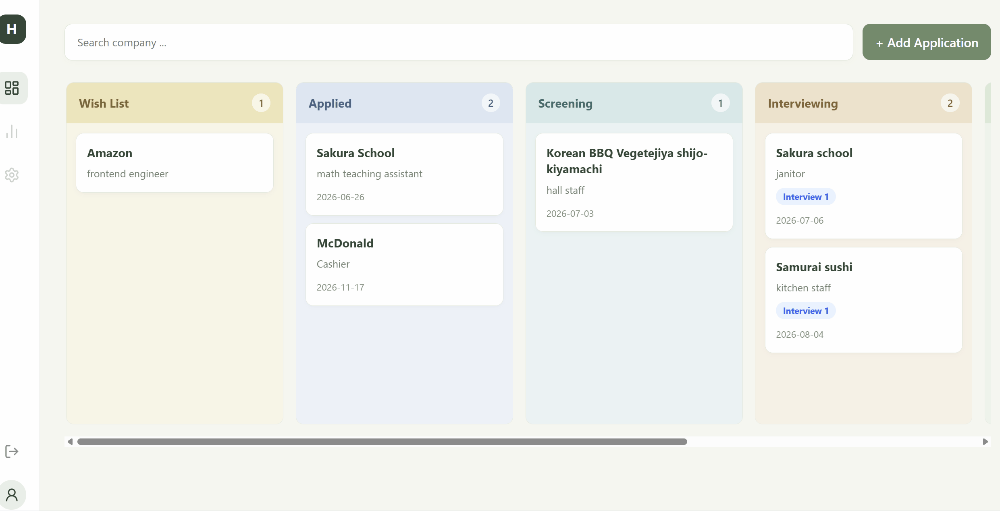
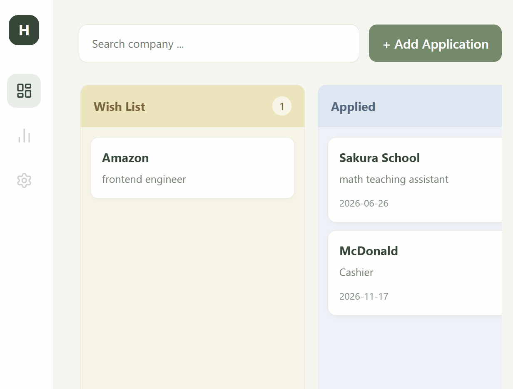

# Job Application Tracker

A full-stack web application for managing job applications and tracking recruitment progress.

就職活動における応募情報や選考状況を管理するフルスタックWebアプリケーションです。

---

## Overview

Job Application Tracker helps users organize their job search in one place. Users can manage applications, track recruitment progress, and keep their application information organized through an interactive Kanban-style board.

The application includes user authentication and ownership-based access control to ensure that each user's application data remains private.

## Features

### 1. User Authentication

- User registration and login
- Session-based authentication
- Password hashing with BCrypt
- CSRF protection
- User-specific data access

**Registration**



**Login**



### 2. Application Management

- Create new job applications
- View application details
- Edit existing application information
- Delete applications
- Record company names, positions, application dates, and notes

**Add Application**



**Edit Application**



**Delete Application**



### 3. Application Tracking

- Kanban-style application board
- Organize applications by recruitment status
- Move applications between stages using drag and drop
- Search applications by company name

**Drag and Drop**



**Search Applications**



---

## Tech Stack

| Category | Technologies |
|---|---|
| Frontend | React 19, TypeScript, Vite, CSS |
| Backend | Java 21, Spring Boot, Spring Data JPA |
| Database | MySQL |
| Authentication | HTTP Session, BCrypt |
| Security | CSRF Protection, Ownership-based Access Control |
| Communication | REST API |

## Architecture

The application follows a frontend-backend architecture.

**Frontend**
- React handles the user interface and application state.
- Communicates with the backend through REST APIs.

**Backend**
- Spring Boot handles business logic and API requests.
- Spring Data JPA manages database operations.
- Handles authentication, session management, and authorization.

**Database**
- MySQL stores user accounts and job application records.
- Each application is associated with its owner through a user relationship.

## What I Learned

- Building a full-stack application using React and Spring Boot
- Designing and implementing REST APIs
- Managing frontend and backend communication
- Implementing session-based authentication
- Understanding password hashing and CSRF protection
- Designing relational database structures
- Implementing ownership-based authorization
- Organizing application components and backend services

## Future Improvements

- Application sorting and advanced filtering
- Recruitment deadline and email tracking
- To-do and memo features
- AI-powered job description analysis
- Docker containerization
- Cloud deployment using AWS

## Running Locally

### Prerequisites

- Node.js
- Java 21
- MySQL

### 1. Clone the repository

```bash
git clone https://github.com/HanKwan/Job-application-tracker.git
cd Job-application-tracker
```

### 2. Database Setup

Create the MySQL database:

```sql
CREATE DATABASE job_tracker;
```

Configure the database connection in the backend application configuration.

### 3. Start the Backend

For Windows:

```bash
cd backend
mvnw.cmd spring-boot:run
```

For macOS / Linux:

```bash
cd backend
./mvnw spring-boot:run
```

### 4. Start the Frontend

Open another terminal:

```bash
cd frontend
npm install
npm run dev
```

Open the local URL displayed by Vite in your terminal.